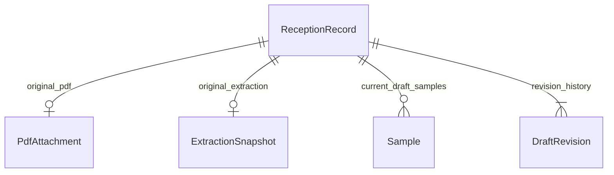

# Mô hình dữ liệu Giai đoạn 3

| Bảng | Vai trò |
|---|---|
| ReceptionRecord | UUID, tham chiếu serial nội bộ HS, trạng thái, version, snapshot khách hàng, thời gian |
| PdfAttachment | Tên gốc, key file, dung lượng, media type, SHA-256; immutable |
| ExtractionSnapshot | JSON nhận dạng gốc của fixture; chưa có dữ liệu nếu PDF chưa được OCR; immutable |
| Sample | UUID ổn định, thứ tự, tên/loại/vị trí/số lượng/chỉ tiêu; thuộc đúng một hồ sơ |
| DraftRevision | Snapshot toàn bộ bản nháp theo version, action, thời điểm; append only |

Một transaction lưu đồng thời các trường hồ sơ, danh sách mẫu, version và revision.
Update với `WHERE id AND version` đóng vai trò optimistic concurrency control.
Nếu một bước lỗi, toàn bộ thay đổi database rollback. UUID mẫu của hồ sơ khác bị từ chối.
Lịch sử chưa gắn danh tính nhân viên vì authentication chưa triển khai.

Migration đã commit ở `backend/prisma/migrations/202610120001_initial/`, gồm FK/index,
constraint và trigger immutable. `prisma migrate deploy` áp dụng migration, không reset database.
Không chạy `migrate reset` trên dữ liệu cần giữ.

Thông tin khách hàng chưa tách thành danh mục dùng chung: cách này bảo toàn thông tin đúng theo
mỗi biên bản, tránh ghi đè thông tin chung chưa được xác minh. Có thể thêm customer master ở giai đoạn phù hợp.
